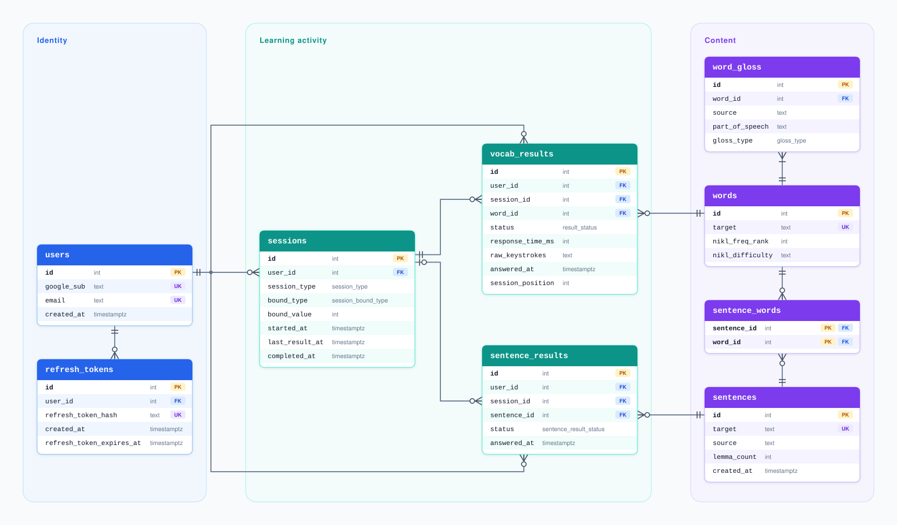

# Language App

Inspired by my own pain points in learning Korean vocabulary. This project will be a clean, data-driven vocabulary management app, focused on efficiency and personalisation. The goal is to make even a 2-minute session genuinely productive, rather than only feel productive.

For users who want to skip the slow-paced gamification bloat from the likes of Duolingo, yet want more accessibility and personalisation than Anki.

Designed to need no setup, to learn your level, and to build your language pack as you go.

## Core Components

### Vocab Session

The core data driver. It works in focused sessions of 2 minutes, where you only need to focus on the word that's shown to you. It will take data on how you respond, and use that to decide the next word to show you. That could be a new word that's suitable for you, or a word you've seen before that's due for review. In this way, it builds your language pack for you.

### Sentence Session

For efficient and in-context vocab review. Sentences are built from the user's words that are due for review. This is inspired by the principles of [comprehensible input](https://comprehensibleinputwiki.org/wiki/Main_Page), making it more effective, efficient and engaging than churning through individual words for review.

### Dashboard

Data visualisation for all the user's vocab metrics. The goal is to introduce interesting visualisations which show progress and an overview on their current vocabulary. This isn't limited to graphs, but intended to extend to heatmaps/bubbles/classification etc. The goal is to characterise their vocab universe through visualisations, and part of their motivation to use this app should be to build up the visualisations.

Currently, it only focuses on two KPIs: the number of words they have, and their total number of reviews.

## Documentation

While building this, I have kept a log of my reasoning and decisions made in [log.md](docs/log.md). There is also a list of [principles](docs/principles.md).

Each feature has a reference document in [`docs/`](docs/), which serves as context and as a running space for notes such as design ideas, edge cases and open questions.

## Entities

Table grains:

- `users` - One row per user, created on first Google sign-in
- `sessions` - One row per session started (vocab or sentence), including abandoned ones with metadata
- `words` - One row per lemma in the target language, with its deterministic facts (frequency, difficulty)
- `word_gloss` - One row per accepted translation of a word, in long format to account for homographs and synonyms
- `vocab_results` - One row per vocab answer, creating the results from which everything else is derived
- `sentences` - One row per sentence pair, shared across users so LLM cost diminishes
- `sentence_words` - One row per word in a sentence, acting as a junction between sentences and words
- `sentence_results` - One row per sentence answer
- `refresh_tokens` - One row per live refresh token, stored as a hash and deleted after single use

## Key Architecture and Design Decisions

### Shared Sentence Corpus as Cache

Sentences are only pulled from a shared corpus, and only if applicable sentences don't already exist are new sentences generated by LLM and inserted into the table, for the query to be repeated. It serves as a cache for sentences, so the number of API calls would diminish as more sentences populate the table.

It's considered to seed the sentences with sentences scraped from online, though licensing needs to be closely considered.

### Data Capture

The results are a single source of truth. It is from this alone that everything is derived and processed. The results data taken:

- **Time to respond**: Relatively fast response per-keystroke signals high confidence
- **Peeked status**: Signals uncertainty if answer is checked, but interest - and at least learnt once
- **Skipped status**: Signals disinterest in the word
- **Full keystroke history**: Starting to type a different word shows low confidence
- **Response timestamp**: To incorporate spaced repetition on reviews
- **Position in the session**: Earlier words possibly systematically faster than later words

### Perceived Immediacy

One of the key considerations is perceived immediacy. Network roundtrips are therefore minimised from the user's perspective:

- **Prefetch on mount**: Initial session batch fetched before the user clicks start
- **Session batches fetched ahead**: Next batch fetched when the user's current batch goes below a threshold
- **Answers checked in browser**: Answer is checked locally on each keystroke with immediate advancement
- **Results sent in background**: Results are only sent after word advancement so the UI doesn't wait on network

### Lemmatisation

Words appear in sentences conjugated and with particles attached. For example, 먹었어요 and 먹고 are the same verb, but wouldn't link back to 먹다 by string matching.

Words are therefore only stored as lemmas. A lemma is the citation form of the word. The `kiwipiepy` library is used to extract the lemma from the surface form of each word in the sentence, so that every lemma deterministically maps to a word's ID in `sentence_words`. This enables relation with the user's word, for example evaluating the percentage of words in a sentence that the user knows. Any word that the lemmatiser function does not produce will be missed, therefore it's important to validate that every word in the `words` table is a lemma.

### Bounded Sessions

Sessions have a defined start and finish with a summary at the end, so effort and reward feel connected and the psychological loop closes. Vocab sessions are bound by time (currently 2 minutes), sentences by count. It ties in with psychological principles to lower barriers to starting and encourage completion. See the [decision to bound sessions](docs/log.md#2026-08-02---sessions-vocab-sessions-are-bound-by-time-sentences-are-bound-by-count).

### Auth

Sign-in only via Google Sign-In (OpenID Connect), so that there are no passwords stored, and only the bare minimum is kept (`sub` and `email`). All verification is server side, with a JWT access token for the frontend, and single-use refresh token, stored as httpOnly cookies.

## Not Yet Built

- Word selection algorithm - currently takes the words at random as a placeholder
- Semantic equivalence checking
- Cold start solution
- Rate limiting
- Evaluations
- Error monitoring
- Failure handling
- Data deletion and export
- Frontend UX and UI

## Known Problems to Solve

### New Word Selection

The selection algorithm has three layers: which seen word is most due for review, which unseen words are most suitable, and when to introduce one. Thoughts are to start simple with the open source FSRS for review words, and a selection algorithm for new words. New word selection could sample from a distribution centred on their estimated level, where a level maps to a specific word, as a function of a word frequency, difficulty grade, and TOPIK level ranking. There will additionally be a policy that determines when a new word should be shown. This will form the basic algorithm to build on with more advanced techniques.

See the [core questions](docs/log.md#2026-10-08---business-logic-core-questions-to-focus-on) and the [choice of FSRS](docs/log.md#2026-10-08---algorithm-words-due-for-review-are-determined-by-modelling-memory-estimating-each-words-recall-probability-and-seeing-which-fall-below-a-threshold).

### Semantic Equivalence

A core challenge is passing semantically correct answers written differently. E.g., 'I went to the store yesterday' is equivalent to 'yesterday I went to the store'. Currently, answers must match the English exactly.

- For vocab, the Korean word will have multiple accepted glosses in `word_gloss`. E.g., 보다 ('to see') will also accept 'to look'. All alternatives will be sent in the same query.
- For sentences, an answer should pass if it contains all key lemmas, irrespective of order, with minor words being disregarded. The key lemmas may also require their glosses to be checked for too.

### Cold Start Problem

The selection algorithm assumes there is already data to work with. A new user will need to be treated differently to one with existing data. Earlier sessions should therefore be about building an initial word vault and exploring the user's level, while later sessions phase into progressing their level with new words and building confidence in review words.

The current thinking is to start with a curated sample of the easiest words that are most fundamental building blocks of sentences, and gauge the user's level from how they respond. An experienced user would be able to churn through the initial stages quickly - for example, many words answered correctly first try with few peeked is a strong signal. A lot of 'peeked' words would show their approximate level.

Also considered is letting the user speed this up by adding words they already know, which would act as priors.

## Future Scope

Adapt to make it target-language agnostic. It should be generalised for use equivalently by both Korean speakers learning English and English speakers learning Korean.

## Data Sources

Vocabulary source: National Institute of Korean Language (NIKL), Korean Learning Vocabulary List, used under KOGL Type 1: [source](https://www.korean.go.kr/front_eng/down/down_02V.do?etc_seq=70).

NIKL has also granted access to a corpus of natural spoken Korean. It can be used for analysis only, e.g., for word frequency and particle patterns in real speech and as a benchmark for evaluating generated sentences. The licence doesn't allow the sentences themselves to be shown in the app.

## Tech Stack

- **Backend**: Python, FastAPI, Pydantic
- **Frontend**: React, TypeScript, Vite, TanStack Query, React Router, Tailwind
- **Database**: PostgreSQL 18, SQLAlchemy, Alembic
- **Auth**: Google Sign-In (OpenID Connect), python-jose
- **Testing**: Pytest, GitHub Actions
